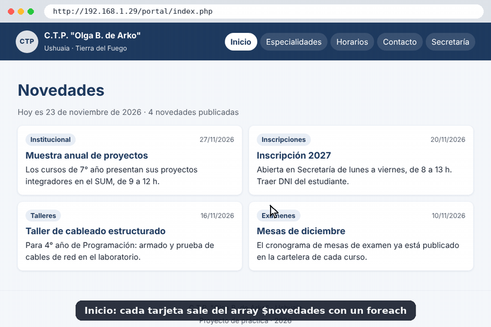
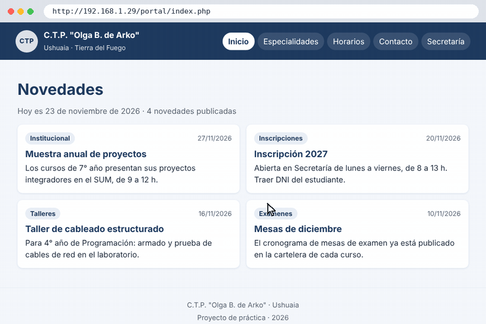
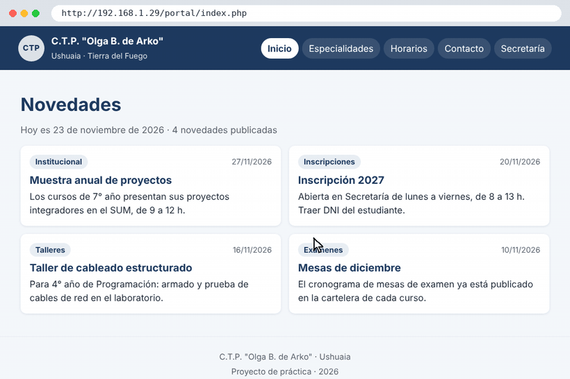
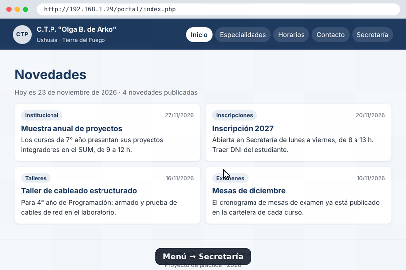

# Portal Escolar · C.T.P. "Olga B. de Arko"

<!-- TECNOLOGÍAS -->


<!-- CARACTERÍSTICAS -->


## Descripción

Portal web institucional desarrollado para el **Colegio Técnico Provincial (C.T.P.) "Olga B. de Arko"**, orientado a centralizar y presentar información relevante de la comunidad educativa.

Desarrollado con **PHP puro**, CSS3 y JavaScript, sin utilizar frameworks ni sistemas de gestión de bases de datos.

Incluye secciones de **novedades institucionales**, especialidades, horarios organizados por curso y un formulario de contacto. Incorpora además un **generador de constancias docentes**, con formato preparado para impresión.

> **Proyecto de práctica.** Las novedades, materias, horarios y constancias utilizan datos de ejemplo. Las constancias generadas incluyen la marca de agua "MODELO · SIN VALIDEZ OFICIAL", sin firma ni sello institucional.

## Demo

| Inicio | Especialidades |
|---|---|
|  |  |
| **Horarios** | **Contacto** |
|  |  |
| **Secretaría · Constancias** | |
|  | |

GitHub no ejecuta PHP: la demo en vivo corre en un servidor Linux con Apache (más abajo, cómo instalarlo).

## Qué tiene

| Página | Qué hace | Qué usa |
|---|---|---|
| **Inicio** · `index.php` | lista las novedades con su categoría y fecha | array de arrays, `foreach`, `if` para el caso sin novedades, `date()` + `strtotime()` |
| **Especialidades** · `especialidades.php` | materias de cada año, por especialidad | array de tres niveles, `foreach` anidados |
| **Horarios** · `horarios.php?curso=4-1` | horario semanal del curso elegido | formulario **GET**, lista blanca con `array_key_exists`, `for` + `foreach` para armar la tabla |
| **Contacto** · `contacto.php` | formulario con nombre, email, asunto y mensaje | formulario **POST**, validación en el servidor, `filter_var`, `mb_strlen`, los datos vuelven al formulario si hay errores |
| **Secretaría** · `constancias.php` | constancia de servicio, de horario o de asistencia a jornada | POST, `switch`, `date()`, número correlativo guardado en un archivo, `@media print` y un botón de imprimir |

Lo común está en un solo lugar: `includes/header.php` y `includes/footer.php` (con `require`), las funciones en `funciones.php` y los datos de ejemplo en `datos.php`. Todo el código está comentado línea por línea.

## Seguridad

- **Validación del lado del servidor.** Los atributos `required` o `type="email"` del HTML son una comodidad: se saltean con F12 o con `curl`. PHP valida todo de nuevo.
- **Lista blanca.** El curso, el asunto y el tipo de constancia solo pueden ser valores conocidos; cualquier otro se descarta.
- **Escapar la salida.** Todo lo que se muestra pasa por `e()`, que usa `htmlspecialchars`. Si alguien escribe `<script>`, se ve como texto y no se ejecuta (previene XSS).
- **Datos raros.** `limpiar()` descarta lo que no sea texto (por ejemplo, `?curso[]=4-1`) en vez de romper la página.
- **Mínimo privilegio.** Apache solo puede escribir en `almacen/`, donde guarda el número correlativo.
- **Nada sensible por GET.** Los datos de la URL quedan en el historial, en el `access.log` de Apache y en el *Referer* de la página siguiente.

## Estructura

```
portal/
├── index.php            Inicio
├── especialidades.php   Especialidades
├── horarios.php         Horarios (GET)
├── contacto.php         Contacto (POST)
├── constancias.php      Secretaría · Constancias
├── datos.php            datos de ejemplo en arrays
├── funciones.php        e(), limpiar(), validar_dni(), fecha_larga(), siguiente_numero()…
├── includes/
│   ├── header.php       <head>, marca y menú
│   └── footer.php       pie y fin del HTML
├── css/styles.css       estilos (mobile first + impresión)
├── js/imprimir.js       botón Imprimir (el único JavaScript)
├── almacen/             acá Apache guarda contador.txt (no se sube al repo)
└── docs/demo/           los GIF de este README
```

## Instalación

**Requisitos:** PHP 8.0 o más nuevo, con la extensión `mbstring`, y un servidor web (Apache).

### En Ubuntu (LAMP)

```bash
sudo apt install apache2 php libapache2-mod-php php-mbstring git
cd /var/www/html
sudo git clone https://github.com/Prof-NkoCussi/portal-escolar-php.git portal
sudo chown -R $USER:www-data portal     # los archivos son tuyos; el grupo es el de Apache
chmod 775 portal/almacen                # Apache solo escribe en esta carpeta
```

Abrir `http://IP-DEL-SERVIDOR/portal/`.

### En Windows (XAMPP)

Copiar la carpeta a `C:\xampp\htdocs\portal`, iniciar Apache desde el panel de XAMPP y abrir `http://localhost/portal/`.

> La zona horaria está fijada en `funciones.php` (`America/Argentina/Ushuaia`), porque PHP no toma la del sistema operativo: sin ella usa UTC y las constancias saldrían con 3 horas de más.

## Pruebas

Comprobar la sintaxis sin ejecutar:

```bash
php -l contacto.php
```
```
No syntax errors detected in contacto.php
```

Mandar el formulario de contacto **sin navegador**, con datos inválidos: el `required` del HTML no interviene y PHP igual frena todo.

```bash
curl -s -d "nombre=&email=no-es-mail&asunto=hackeo&mensaje=hola" http://localhost/portal/contacto.php | grep campo__error
```
```
<p class="campo__error">Escribí tu nombre.</p>
<p class="campo__error">El email no es válido.</p>
<p class="campo__error">Elegí un asunto de la lista.</p>
<p class="campo__error">El mensaje es muy corto (mínimo 10 letras).</p>
```

Un curso con código en la URL: se muestra escapado, no se ejecuta.

```bash
curl -s "http://localhost/portal/horarios.php?curso=%3Cscript%3Ealert(1)%3C%2Fscript%3E" | grep aviso
```
```
<p class="aviso aviso--error">El curso «&lt;script&gt;alert(1)&lt;/script&gt;» no existe.</p>
```

## Limitaciones

- El número correlativo se guarda en un archivo de texto: si dos personas generan una constancia en el mismo instante, podrían recibir el mismo número, y si el archivo se borra, la numeración vuelve a 1. En un sistema real lo resuelve una base de datos (`AUTO_INCREMENT`).
- Los mensajes de contacto se validan y se muestran, pero no se guardan ni se envían por correo.
- No hay usuarios ni login: cualquiera puede generar un modelo de constancia, por eso no tiene validez.

## Licencia

[MIT](https://github.com/Prof-NkoCussi/infraestructura-redes-lamp/blob/main/LICENSE) © Prof. Nicolás A. Cussi\
*Full Stack Developer • Data Science • AI*
